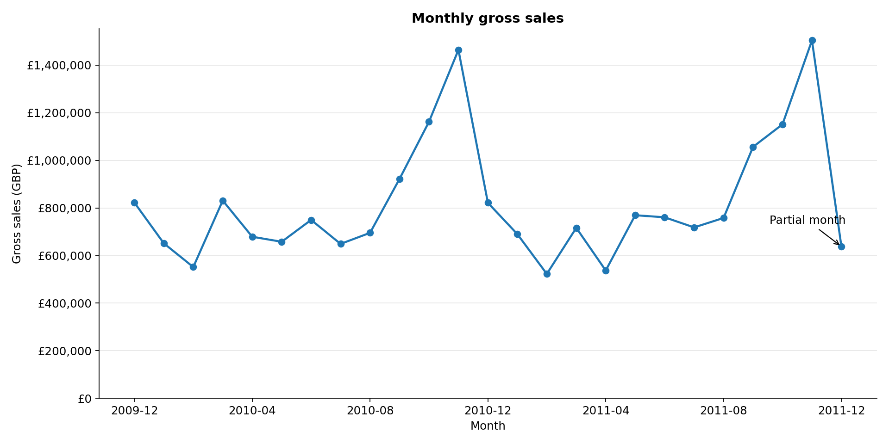
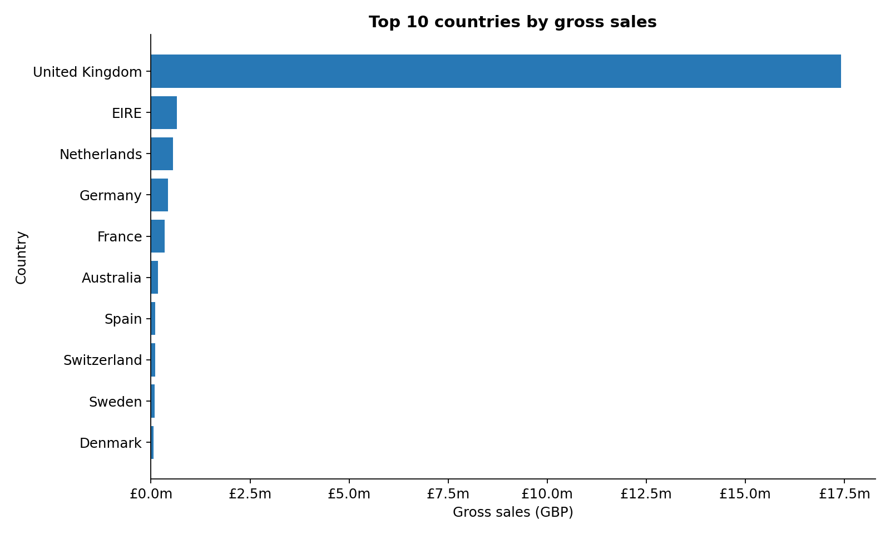
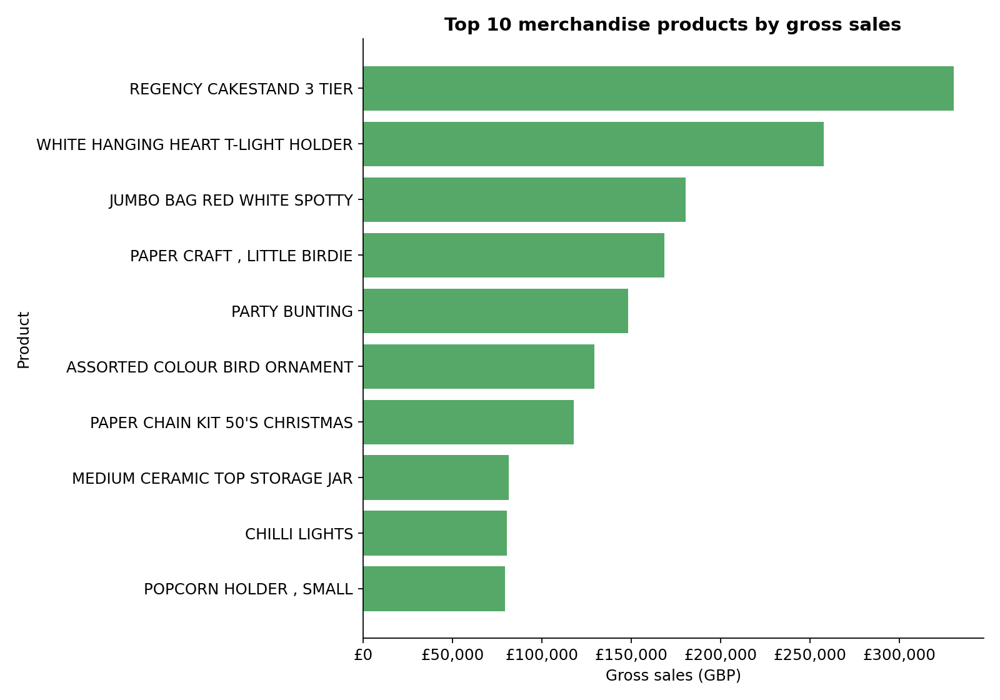
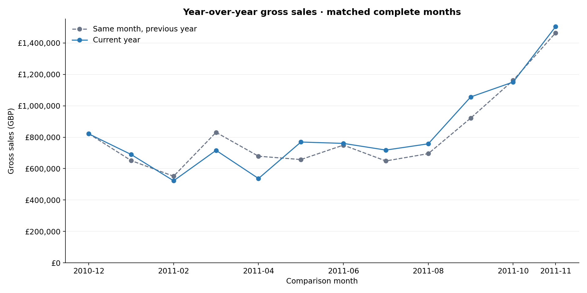

# Retail Sales Data Analysis

**Python · Pandas · Matplotlib · Excel**

I built this project to explore how sales vary over time, which markets and products contribute the most, and how often customers return to purchase. Using more than **one million retail invoice lines**, I developed a reproducible workflow that turns raw transaction data into cleaned datasets, visualizations, and an Excel report.

[View the analysis code](src/analyze_retail.py) · [Download the Excel report](reports/retail_sales_analysis.xlsx) · [Explore the summary tables](reports)

## Highlights

- **Scale:** Cleaned and analyzed 1.07 million invoice lines with a traceable data-quality audit.
- **Business insight:** Found **1.9% growth** in gross sales for January–November 2011 versus the same months in 2010.
- **Analytical judgment:** Excluded partial months from year-over-year comparisons and separated merchandise from other charges for product rankings.
- **Reproducibility:** Generated charts, CSV summaries, and an Excel workbook from one Python pipeline, with six automated tests.

## Project overview

The analysis uses the **Online Retail II** dataset from Kaggle, containing transactions from a UK-based online retailer between **December 1, 2009 and December 9, 2011**.

My focus was on four business questions:

- How do sales change from month to month?
- Which countries contribute the most sales?
- Which products and stock codes generate the highest sales value?
- What proportion of identified customers place repeat orders?

Each source record represents an **invoice line**, so an order can contain multiple records. Throughout this project, gross sales means the value of positive sales lines after cleaning; returns and cancellations are excluded.

## Results at a glance

| Metric | Result |
|---|---:|
| Raw records analyzed | 1,067,371 |
| Valid sales lines after cleaning | 1,007,913 |
| Gross sales | £20,476,260.45 |
| Distinct sales invoices | 40,077 |
| Identified customers | 5,878 |
| Countries represented | 43 |
| Average order value | £510.92 |
| Repeat buyers among identified customers | 72.4% |

## Key findings

### 1. November recorded the strongest monthly sales

November 2011 had the highest observed gross sales at **£1.50 million**, followed by November 2010 at **£1.46 million**. The recurring peak suggests that late-year demand deserves attention when planning inventory and fulfillment capacity.



**Interpretation:** The pattern provides a reason to investigate seasonality, rather than proof of its cause. December 2011 includes only the first nine days, so its lower total should not be interpreted as a full-month sales decline.

### 2. The United Kingdom accounted for most sales

The UK contributed **85.0% of total gross sales**. EIRE and the Netherlands were the next largest country markets by sales value.



**Business relevance:** This concentration makes UK demand particularly important to overall performance. International markets warrant further investigation, but expansion decisions would also require shipping costs, margins, and market context that are unavailable in this dataset.

### 3. Merchandise rankings highlight products rather than charges

The **REGENCY CAKESTAND 3 TIER** stock code leads the merchandise ranking with **£330,590.32** in gross sales.



**Analytical decision:** I grouped records by stock code rather than description, because descriptions can change for the same item. I excluded reviewed codes for postage, manual adjustments, fees, samples, test items, and gift vouchers from product rankings. These entries remain in overall gross sales and are shown separately in [the sales mix table](reports/sales_mix.csv), so the totals still reconcile.

The classification uses an explicit code list in `NON_MERCHANDISE_CODES` plus the `GIFT_` prefix, rather than excluding every alphabetic code: some real products have alphabetic stock codes. It is a practical classification based on observed descriptions, not an authoritative product catalog.

### 4. Repeat purchasing was common among identified customers

Of **5,878 identified customers**, **4,255 placed more than one order**, giving an observed repeat-purchase share of **72.4%**.

I defined a repeat buyer as a customer with more than one distinct sales invoice during the dataset window. Sales lines without customer IDs remain in overall sales totals but are excluded from this customer analysis. This measure describes repeat purchasing within the observed period; it is not a cohort retention rate.

### 5. Comparable-period sales grew modestly

Gross sales increased from **£9.01 million in January–November 2010** to **£9.18 million in January–November 2011**, a **1.9% increase**. I compared the same calendar months to avoid mixing different seasonal periods and excluded December 2011 because it is incomplete.



**Business relevance:** High November sales alone do not imply strong overall growth. The comparable-period result shows modest growth, which supports investigating product and country contributions before recommending broad expansion. The chart also includes the complete December 2010 versus December 2009 pair; the 1.9% headline uses January–November only.

## Suggested next steps for the retailer

| Evidence | Practical next step | Additional information needed |
|---|---|---|
| November peaks in both years | Review stock and fulfillment capacity ahead of late-year demand | Lead times, stockouts, and inventory costs |
| UK contributes 85.0% of gross sales | Monitor UK demand closely and evaluate overseas markets individually | Shipping costs and country-level margins |
| Cake stand leads merchandise sales value | Review its availability and profitability before increasing stock | Product margin and return rate |
| Comparable-period sales grew 1.9% | Investigate which countries and products contributed to growth | Product availability, pricing, and promotion history |

These are recommendations for further investigation; the project does not claim realized improvements in revenue or efficiency.

## Data preparation and methodology

I used Pandas to clean the source data and create consistent inputs for every summary and chart.

| Step | Treatment |
|---|---|
| Standardize fields | Normalize column names, trim whitespace, and convert dates and numeric values. |
| Remove duplicates | Remove 34,335 exact duplicate source rows. |
| Filter invalid sales | Exclude 25,123 distinct remaining rows containing cancellations, non-positive quantities or prices, or other invalid sales fields. |
| Handle missing customers | Retain 228,488 sales lines without customer IDs for sales totals; exclude them from customer-level metrics. |
| Handle missing labels | Use explicit unknown labels for missing descriptions and countries. |
| Calculate sales | Multiply quantity by unit price, preserving source precision until presentation. |
| Aggregate results | Summarize by month, country, stock code, and customer purchase pattern. |

The row counts reconcile as follows:

```text
1,067,371 source rows
 − 34,335 exact duplicates
 − 25,123 other excluded rows
─────────
1,007,913 valid sales lines
```

Individual data-quality issue counts can overlap. The reconciliation above uses distinct excluded rows rather than adding those overlapping counts.

**Metric definitions**

- **Gross sales (GBP):** Sum of `Quantity × UnitPrice` across retained positive-sales lines.
- **Order count:** Number of distinct retained sales invoices.
- **Average order value:** Gross sales divided by distinct sales invoices.
- **Identified customers:** Number of unique, non-missing customer IDs in retained sales.
- **Repeat-purchase share:** Identified customers with multiple sales invoices divided by all identified customers.

## Tools and deliverables

| Tool | Role in the project |
|---|---|
| Python | Reproducible analysis and report-generation workflow |
| Pandas / NumPy | Data cleaning, filtering, aggregation, and metric calculations |
| Matplotlib | Monthly trend, country comparison, and stock-code charts |
| Excel / openpyxl | Formatted workbook with nine sheets and a native trend chart |
| unittest / GitHub Actions | Automated cleaning and reporting checks |

The [Excel report](reports/retail_sales_analysis.xlsx) contains a summary, data-quality audit, customer purchase patterns, monthly sales, country performance, top merchandise products, year-over-year comparisons, sales mix, and methodology notes. Sheets include filters and frozen headers for exploration. Workbook values are calculated by the Python pipeline; rerun the analysis to refresh them.

Aggregate CSVs and chart images are included in this repository so the findings can be reviewed without running the code. Raw data and the customer-level cleaned export are excluded from Git.

## Run the project

### 1. Set up the environment

Use Python 3.11 or newer. From the repository root:

```bash
python -m venv .venv
source .venv/bin/activate
python -m pip install -r requirements.txt
```

On Windows, activate the environment with `.venv\Scripts\activate`.

### 2. Download the data

Download the [Online Retail II dataset from Kaggle](https://www.kaggle.com/datasets/mashlyn/online-retail-ii-uci) and extract it into `data/raw/`.

With the Kaggle CLI installed and credentials configured, you can also run:

```bash
python -m pip install kaggle
kaggle datasets download -d mashlyn/online-retail-ii-uci -p data/raw --unzip
```

Keep **one copy of the dataset** in the input folder to avoid loading both CSV and Excel versions. Never add Kaggle credentials to the repository.

### 3. Run the analysis

```bash
python src/analyze_retail.py
```

The pipeline writes the Excel workbook, CSV summaries, cleaned sales data, and chart images to `reports/`.

To specify another input or output location:

```bash
python src/analyze_retail.py --input data/raw/online_retail_II.csv --output reports
```

CSV and Excel inputs are supported; all sheets in an Excel workbook are read.

### 4. Validate the results

```bash
python -m unittest discover -s tests -v
python scripts/verify_outputs.py
```

The six automated tests cover cleaning, missing customer IDs, product grouping, partial-month labeling, nonfinite values, merchandise classification, year-over-year matching, and report generation. The independent verification script reconciles the source sales total, output summaries, row counts, and workbook structure.

The verification script expects the original Kaggle CSV at `data/raw/online_retail_II.csv` and outputs in `reports/`. Unit tests use small fixtures and run without downloading the dataset. GitHub Actions runs those tests on pushes and pull requests.

## Repository structure

```text
Retail_Sales_Data_Analysis/
├── data/
│   ├── README.md                    # Dataset source and attribution
│   └── raw/                         # Downloaded data; ignored by Git
├── src/
│   └── analyze_retail.py             # Cleaning, analysis, charts, and export
├── scripts/
│   └── verify_outputs.py            # Independent output validation
├── tests/                           # Automated tests using small fixtures
├── reports/
│   ├── figures/                     # Matplotlib charts
│   ├── retail_sales_analysis.xlsx   # Nine-sheet Excel report
│   ├── provenance.json              # Input checksum and analysis metadata
│   └── *.csv                        # Summaries and local cleaned export
├── .github/workflows/tests.yml      # Continuous integration
├── requirements.txt
└── README.md
```

## Assumptions and limitations

- Gross sales exclude returns and cancellations, and do not represent net revenue or profit. Cost and margin data are unavailable.
- Exact duplicates are treated as redundant records, although some identical lines could represent legitimate repeated purchases.
- Missing customer IDs limit customer analysis, and customers have different amounts of observation time within the dataset window.
- Overall gross sales retain non-merchandise charges; the product ranking excludes explicitly reviewed codes. This classification may need refinement with a product catalog. Wholesale activity can influence order sizes.
- December 2011 is incomplete. Country is the available geographic field; regional comparisons are not supported.
- Findings describe this historical retailer and period. Recommendations are areas for further investigation, not measured business outcomes.

## What I learned

This project reinforced the importance of defining metrics before interpreting results. Distinguishing invoice lines from orders, gross sales from net revenue, and repeat purchasing from retention changed how I structured the analysis. Recording exclusions and reconciling totals also made the final reports easier to explain and reproduce.

## Dataset attribution

**Kaggle source:** [Online Retail II UCI](https://www.kaggle.com/datasets/mashlyn/online-retail-ii-uci)

**Original publisher:** Chen, D. (2012). *Online Retail II* [Dataset]. UCI Machine Learning Repository. [https://doi.org/10.24432/C5CG6D](https://doi.org/10.24432/C5CG6D).

The original dataset is licensed under **CC BY 4.0**. See the [UCI dataset documentation](https://archive.ics.uci.edu/dataset/502/online+retail+ii) and [local source notes](data/README.md). The exact analyzed input is identified by its SHA-256 checksum in [provenance.json](reports/provenance.json).
